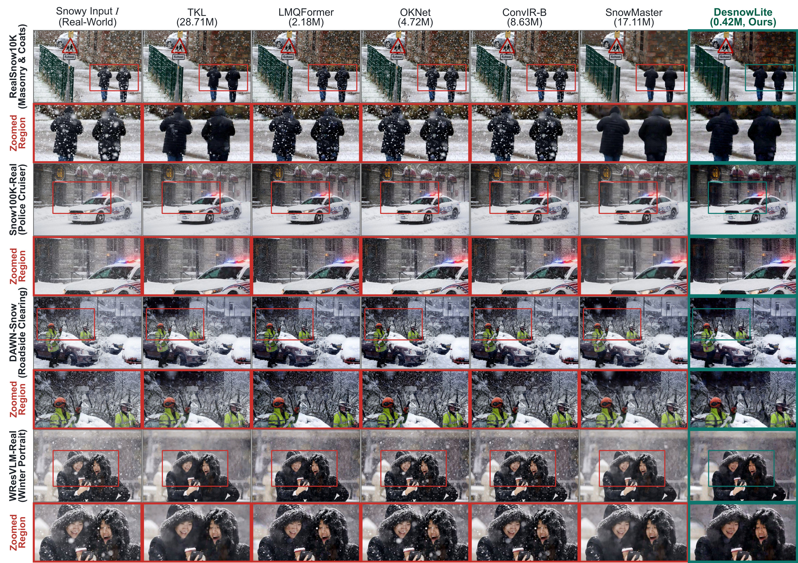

# DesnowLite

PyTorch implementation of **DesnowLite: Lightweight Real-World Desnowing via Physics-Guided Inversion and Self-Supervised Adaptation** (Submitted to *IEEE TIP*).

Jin Liang (`jin2.24@intl.zju.edu.cn`), Yu Lin (`yulin@intl.zju.edu.cn`) · Zhejiang University

DesnowLite removes falling snow and atmospheric veil from real-world images with a **0.42M-parameter** physics-guided network and 2,000-step self-supervised adaptation on unlabeled snowfall, running at **57.3 ms** (42.4 ms with CUDA Graph) per 1080p frame on an A100 without test-time masks.

<p align="center">
  
</p>

## Results

Evaluated on 4 seen real-snowfall datasets (5,670 images), 4 zero-shot unseen datasets (2,962 images), and a 110-observer 4-AFC study:

| Method | Params (M) ↓ | GMACs ↓ | 1080p (ms) ↓ | Seen $`\mathcal{R}_{\mathrm{flake}}`$ ↑ | Unseen $`\mathcal{R}_{\mathrm{flake}}`$ ↑ | Human Pref. ↑ |
| :--- | :---: | :---: | :---: | :---: | :---: | :---: |
| TKL (CVPR'22) | 28.71 | 24.56 | 96.9 | 0.034 | 0.051 | 10.7% |
| LMQFormer (TCSVT'23) | 2.18 | 22.45 | 510.8 | 0.048 | 0.032 | — |
| ConvIR-B (TPAMI'24) | 8.63 | 70.95 | 244.1 | 0.032 | 0.017 | 11.4% |
| SnowMaster (CVPR'25) | 17.11 | 15.96 | 142.5 | 0.055 | 0.061 | 17.8% |
| **DesnowLite (Ours)** | **0.42** | **0.88** | **57.3** | **0.175** | **0.151** | **60.1%** |

## Setup & Inference

Pretrained weights (`desnowlite_042m_2k.pth` and `desnowlite_042m_stage1.pth`) are included in `checkpoints/`.

```bash
pip install -r requirements.txt

python evaluation/infer.py --input path/to/snowy.jpg --output path/to/restored.png
python evaluation/infer.py --input path/to/snowy_dir --output path/to/out_dir --save-compare
```

## Training

```bash
# Stage-1 synthetic pretraining (CSD)
python stage1_pretrain/train_stage1.py --data /path/to/CSD

# Stage-2 4-region self-supervised adaptation (2K steps)
python stage2_selfsup/train_stage2.py --real-dir /path/to/real_snow --csd-root /path/to/CSD
```

## Evaluation

```bash
# Real-world unpaired benchmarks (R_flake, NIQE, BRISQUE)
python evaluation/eval_benchmarks.py --real-dir /path/to/images
```
